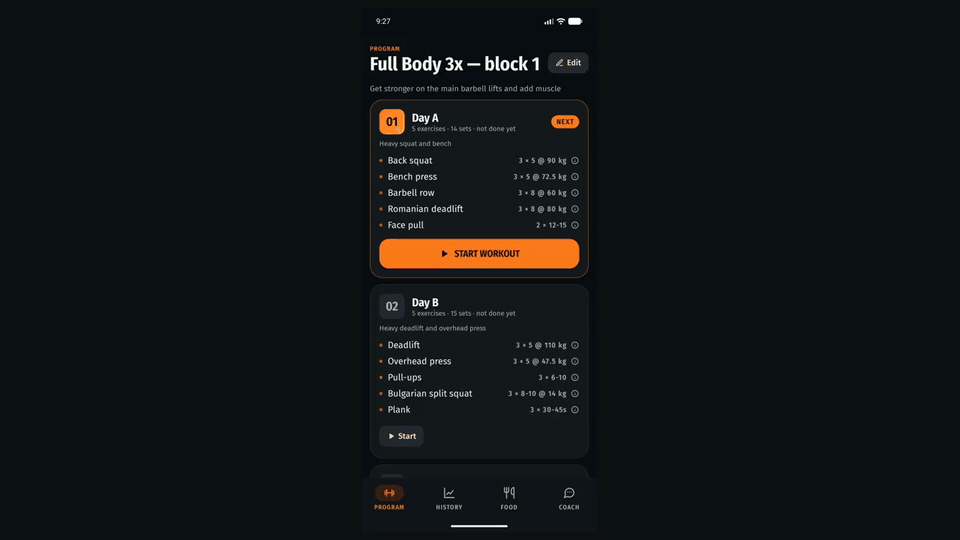

# LiftBrain MCP server

LiftBrain is a strength-training log with an AI coach. You log every set in the phone app (weight, reps, done or
missed); your AI assistant connects to this MCP server, writes your program, reads what you actually lifted and
adjusts the next workouts. It can also log meals, body weight and measurements, and take sleep, resting heart rate
and HRV from Apple Health or Health Connect into account.



- Server URL: `https://liftbrain.online/mcp` (Streamable HTTP, OAuth 2.1 with dynamic client registration)
- App: [Google Play](https://play.google.com/store/apps/details?id=online.liftbrain.app), iOS coming soon
- Website: [liftbrain.online](https://liftbrain.online) · [Privacy policy](https://liftbrain.online/privacy)

## Connect

**Claude (claude.ai, desktop and mobile):** Settings → Connectors → Add custom connector → paste
`https://liftbrain.online/mcp`. Claude opens the LiftBrain sign-in page: sign in with your app account, or create
one there and install the app later.

**Claude Code:**

```bash
claude mcp add --transport http liftbrain https://liftbrain.online/mcp
```

Any other MCP client that supports remote servers with OAuth works the same way.

Then ask something like: *"Look at my profile and write me a 3-day upper/lower program"*, and after a few
workouts: *"How is my bench going? Set the weights for next week."*

## Tools

| Area | Tools |
| --- | --- |
| Overview and profile | `liftlog_overview`, `liftlog_set_profile` |
| Program | `liftlog_get_program`, `liftlog_set_program`, `liftlog_find_exercise` |
| Workouts and analysis | `liftlog_get_sessions`, `liftlog_exercise_history`, `liftlog_set_recommendations`, `liftlog_add_note` |
| Health | `liftlog_get_health` |
| Food | `liftlog_log_meal`, `liftlog_get_meals`, `liftlog_delete_meal`, `liftlog_get_meal_photos`, `liftlog_delete_meal_photo`, `liftlog_set_nutrition_targets` |
| Recipes | `liftlog_get_recipes`, `liftlog_save_recipe`, `liftlog_delete_recipe` |
| Body | `liftlog_log_weight`, `liftlog_get_weights`, `liftlog_log_measurements`, `liftlog_get_measurements`, `liftlog_get_body_photos`, `liftlog_delete_body_photo` |

Weights are in kilograms in every tool; the app shows kg or lb.

## Privacy

The server acts only as the signed-in user and can read and write only that user's data. Accounts and all their data
can be deleted at any time from the app or at [liftbrain.online/delete-account](https://liftbrain.online/delete-account).
